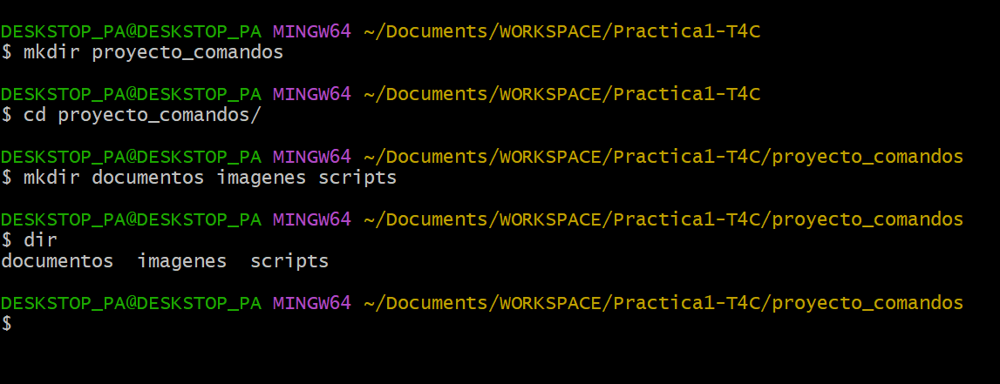
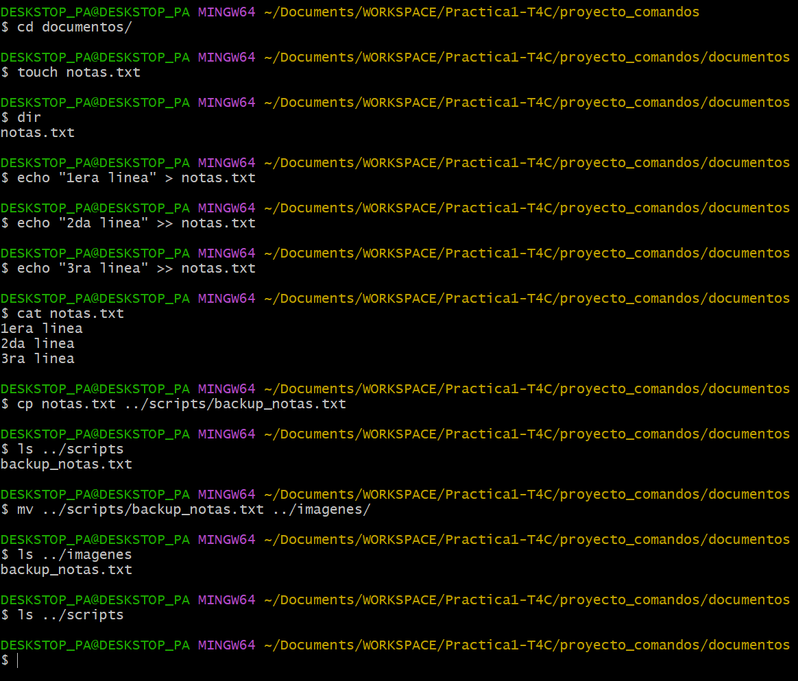
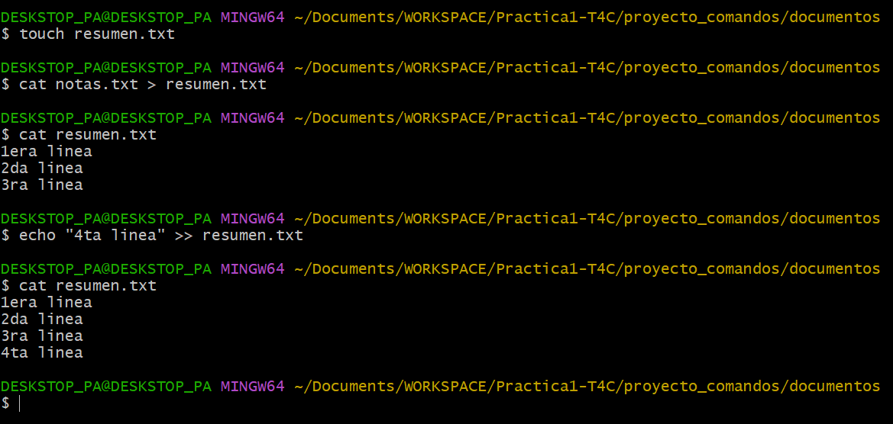
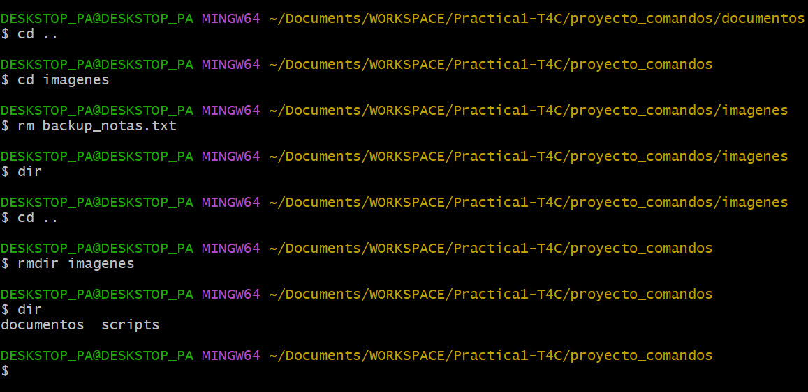

# TAS1 - Estructura
## 1. Título
Creación y Manipulación de Archivos y Directorios con Comandos de Linux
## 2. Tiempo de duración
40 min
## 3. Fundamentos

Descripción de los conceptos para poder entender la práctica (al menos 300 palabras).

La interfaz de línea de comandos (CLI) de Linux es una herramienta esencial para la administración y desarrollo de sistemas. Esta práctica se centra en el uso de comandos fundamentales para gestionar el sistema de archivos, que es la estructura jerárquica que organiza todos los archivos y directorios en Linux.

**Comandos de Estructura y Contenido:**
- mkdir: Crea directorios.
- rmdir: Elimina directorios (solo si están vacíos).
- touch: Crea un archivo vacío o actualiza la fecha de modificación de uno existente.
- cp: Copia archivos o directorios.
- mv: Mueve o renombra archivos y directorios.
- rm: Elimina archivos.
- echo: Muestra texto en la salida estándar (se usa para insertar texto en archivos).
- cat: Muestra el contenido de un archivo.

## 4. Conocimientos previos
   
- Comandos básicos de Linux (cd, ls, pwd).
- Manejo de la Terminal (GitBash, PowerShell, o terminal nativa).
- Uso de operadores de redirección (>, >>).
- Manejo básico de Git y GitHub para la creación del repositorio y la subida de archivos.

## 5. Objetivos a alcanzar
   
Los objetivos alcanzados con la realización de esta práctica fueron:

- Crear y organizar una estructura jerárquica de directorios mediante el comando mkdir.
- Manipular archivos de texto creando contenido mediante el comando echo y el operador de redirección.
- Dominar la gestión de archivos al copiar (cp) y mover/renombrar (mv) archivos entre diferentes directorios.
- Eliminar de forma segura archivos (rm) y directorios vacíos (rmdir).
- Documentar la práctica volcando el historial de comandos a un archivo de texto.
  
## 6. Equipo necesario
  
- Computador con sistema operativo Windows/Linux/Mac.
- Terminal/Shell (GitBash en Windows).

## 7. Material de apoyo
   
- Documentación oficial de comandos de Linux.
  
## 8. Procedimiento

**Paso 1: Creación de la Estructura de Directorios**
Se creó el directorio principal y se ingresó a él para crear las subcarpetas necesarias.

```bash
mkdir proyecto_comandos
cd proyecto_comandos
mkdir documentos imagenes scripts
```



**Paso 2: Creación de Archivos y Contenido**
Dentro del directorio documentos, se creó el archivo notas.txt y se insertaron tres líneas de texto usando echo y los operadores de redirección (> para la primera línea, >> para las siguientes).

```bash
cd documentos
echo "Primera linea de notas." > notas.txt
echo "Segunda linea importante." >> notas.txt
echo "Tercera linea con informacion clave." >> notas.txt
cat notas.txt
```

**Paso 3: Copia y Movimiento de Archivos**
Se copió notas.txt al directorio scripts, renombrándolo como backup_notas.txt, y luego se movió este archivo al directorio imagenes.

```bash
cp notas.txt ../scripts/backup_notas.txt
mv ../scripts/backup_notas.txt ../imagenes/
```



**Paso 4: Redirección y Concatenación para Resumen**
Se creó resumen.txt y se usó cat con el operador de sobrescritura (>) para volcar el contenido de notas.txt. Luego, se añadió una nueva línea usando el operador de concatenación (>>).

```bash
cat notas.txt > resumen.txt
echo "Esta linea se añade al final de resumen.txt." >> resumen.txt
cat resumen.txt
```



**Paso 5: Eliminación de Archivos y Carpetas**
Se regresó al directorio padre (proyecto_comandos) para eliminar el archivo de backup y, dado que la carpeta imagenes quedó vacía, se procedió a eliminarla.

```bash
cd ..
rm imagenes/backup_notas.txt
rmdir imagenes
```



## 9. Resultados esperados
    
El resultado esperado de la práctica fue la validación de las operaciones del sistema de archivos mediante la ejecución correcta de los comandos de Linux.

## 10. Bibliografía
    
- Kinsta. (s.f.). Comandos de Linux: Más de 30 para Manejar tu Terminal. Recuperado de https://kinsta.com/es/blog/linux-comandos/
- Linux Hint. (s.f.). How to Create a New File in Git Bash. Recuperado de https://linuxhint.com/create-new-file-in-git-bash/
- PhoenixNAP. (s.f.). Linux Echo Command (Display Text or Variable Values). Recuperado de https://phoenixnap.com/kb/echo-command-linux